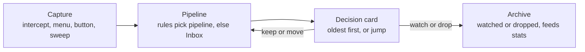

# YouTube Flow Extension — Spec

Last updated: Oct 25, 2026

## Overview

A Firefox and Chrome extension that replaces opening YouTube videos in new tabs with sending them to pipelines, so they get processed later rather than piling up as 80+ open tabs.

- **Problem:** interesting videos get opened in new tabs "for later", never watched, and the tabs accumulate. YouTube's Watch Later has not worked for this.
- **Core idea:** capture a video into a pipeline instead of a tab. Then work through pipelines on a schedule and decide, one card at a time, whether it is still worth watching or was a heat-of-the-moment click.
- **Success looks like:** no backlog of YouTube tabs; pipelines get regularly reviewed; dropped items are visible as a stat rather than as guilt.

## Scope and platforms

v1 is a desktop browser extension for Firefox and Chrome/Chromium, built from one codebase, that captures regular YouTube videos.

| Area | In v1 | Later | Out |
| --- | --- | --- | --- |
| Browsers | Firefox, Chrome/Chromium |  | Safari |
| Content | Regular YouTube videos | Other links (articles, docs, other sites) |  |
| YouTube link types | Regular videos |  | Shorts, playlists, livestreams/VODs |
| Devices | Desktop browser |  | Phone / YouTube app capture |
| Sync | Manual JSON export/import between browsers |  | Cloud sync, own backend |

Capture sources that must work: the YouTube homepage and recommendations, links to YouTube on other sites, and suggestions inside a video being watched (sidebar, end screens).

The data model should stay link-agnostic so non-YouTube items can be added later without a migration.

## Core concepts

Every captured video lands in a pipeline: the built-in Inbox by default, or a user-made pipeline chosen at capture time or by a rule.

- **Inbox:** a built-in default pipeline. Captures with no explicit target or matching rule land here, ready to sort later.
- **Pipeline:** a named list the user creates, renames, reorders and deletes (for example "Programming", "Fun"). Pipelines are processed oldest-first by default. There is no hard size limit, but warnings are allowed (see Reminders).
- **Item:** one captured video, with metadata (title, channel, duration, thumbnail, URL), when it was added, how it was captured, and its status.
- **Item status:** queued, watching, watched, or dropped. Watched and dropped items move to the Archive.
- **Rule:** a condition that sends new captures to a specific pipeline instead of the Inbox, for example by channel, keyword, or video length.
- **Archive:** watched and dropped items, kept for stats and history.

Keep and Move return an item to a pipeline. Watch and Drop end in the Archive, where it can still be restored.

## Capture

Every capture method writes to the same place. Intercepting is the default, and holding a modifier key bypasses it.

1. **Intercept new-tab opens.** Middle-click or Ctrl/Cmd-click on a YouTube video link, on any site, captures the video instead of opening a tab. It goes to the Inbox, or to the matching pipeline if a rule applies. A brief confirmation toast shows which pipeline it landed in.
2. **Bypass with a modifier.** Shift plus middle-click opens a real tab as normal, for when you actually want to watch now. An optional setting, off by default, also intercepts plain left-clicks on YouTube links.
3. **Right-click → Send to pipeline.** A context menu on any YouTube video link or thumbnail, with a submenu listing Inbox plus every user pipeline.
4. **Capture this tab.** A toolbar and/or page button on an open video: captures it and closes the tab.
5. **Sweep open tabs.** A one-off action that collects all currently open YouTube video tabs into a pipeline and closes them. This is for clearing the existing backlog.

**Rules.** Rules route new captures automatically. Each rule has a condition and a target pipeline. The first matching rule wins, and no match means the Inbox. v1 conditions are channel, keyword in title, and duration range. Explicitly choosing a pipeline in the right-click menu overrides the rules.

## Processing

Processing works one card at a time, oldest first, and each card ends in exactly one decision.

- **Pop:** shows the next item as a decision card with thumbnail, title, channel, duration, and time spent in the pipeline, plus an AI summary if one was requested.
- **Decisions on the card:**
  - **Watch** opens the video in a new tab and marks it as watching.
  - **Keep** sends it to the back of the pipeline.
  - **Move** sends it to another pipeline.
  - **Drop** archives it as "not worth it" (heat of the moment).
- **Jump:** in the pipeline list view, any item can be opened directly. This skips the FIFO order without changing it.
- **Watched detection:** a content script on the opened video tab marks the item watched automatically at about 90% playback. The threshold is configurable, and the item can be manually marked watched or reverted.
- **Undo:** the last decision can be undone (for example from a toast), so mis-clicks don't lose items. Default shortcuts are W (Watch), K (Keep), M (Move) and D (Drop), configurable in settings.

## Reminders

Three kinds of reminders keep pipelines from becoming another graveyard. Nothing is ever deleted automatically.

| Reminder | Trigger | Shows |
| --- | --- | --- |
| Badge count | Always on | Number of unprocessed items on the toolbar icon (Inbox only or all pipelines, configurable) |
| Scheduled notification | Times the user sets up; no default schedule | "You have N videos to process" → opens the processing page |
| Threshold notification | A pipeline passes a user-set count | "Programming has 25 items" → opens that pipeline |

Each reminder type can be toggled on or off, and thresholds are set per pipeline. Clicking a notification opens the full page straight into processing mode.

## AI summaries

Summaries are generated on demand from the decision card, through a pluggable provider the user configures with their own key.

- **Trigger:** a "Summarize" button on the card. Nothing is sent automatically.
- **Providers:** Claude (Anthropic API), OpenAI, DeepSeek, and Ollama (local), behind one provider interface so others can be added. Settings hold the provider, model, API key or Ollama URL.
- **Input:** the video's transcript or captions. Captions are read from the video page. A video without captions shows "No transcript available" and is not summarized.
- **Output:** a one-line TL;DR, key points as bullets, timestamps of key parts, and a short "worth watching?" verdict, shown on the card and cached on the item, so it's only generated once.
- **Keys:** stored locally in extension storage only and never exported in the JSON backup unless explicitly chosen.
- **Failure:** no transcript or a provider error shows a clear message on the card. The decision still works without a summary.

## Archive and stats

Watched and dropped items move to a searchable Archive, which also feeds a small stats view.

- **Archive:** a list of watched and dropped items, filterable by pipeline, outcome, and date. Any item can be restored to a pipeline.
- **Stats (all in v1):**
  - Share dropped vs watched, the "heat of the moment" rate, overall and per pipeline
  - Items captured vs processed per week
  - Average time an item waits before a decision
  - Total watch time from watched items

## UI surfaces and design

There are two surfaces: a quick toolbar popup and a full extension page for processing sessions. Both should be built on one polished design system with purposeful animation.

**Surfaces**

| Surface | Purpose | Contents |
| --- | --- | --- |
| Toolbar popup | Quick glance and quick actions | Pipeline counts, "Capture this tab", "Sweep tabs", intercept status, open full page |
| Full page (extension tab) | Processing sessions and management | Decision-card flow, pipeline lists with jump, rules editor, archive, stats, settings |
| In-page | Feedback at capture time | Toast confirming "Added to Inbox" with an undo action and a change-pipeline option |

**Design direction**

- Modern, compelling, and highly polished. The references are Emil Kowalski's work ([emilkowal.ski/skill](https://emilkowal.ski/skill)) and "UI/UX max" level craft.
- A well-defined design system: color, type, spacing and radius tokens, light and dark themes, and a small set of reusable components (card, list row, toast, menu, dialog, button, input).
- Animation is used where it carries meaning: cards sliding or flying out on a decision, items reordering, toasts entering and leaving, and counts ticking. It should be fast and interruptible, and respect `prefers-reduced-motion`.
- Keyboard-first processing: shortcuts for Watch, Keep, Move, Drop, and Undo on the decision card (W, K, M, D by default, configurable).

The linked design reference could not be opened while writing this. Its specific guidance still needs to be pulled in.

## Data model and storage

All data is stored locally in each browser, and a versioned JSON export/import moves it between Firefox and Chrome.

| Entity | Key fields |
| --- | --- |
| Pipeline | id, name, order, isInbox, sortOrder (default FIFO), thresholdWarn |
| Item | id, url, kind (`youtube-video`, later other links), videoId, title, channel, durationSec, thumbnailUrl, pipelineId, status, addedAt, captureMethod, decidedAt, summary |
| Rule | id, order, condition (channel / keyword / duration range), targetPipelineId, enabled |
| Settings | intercept on/off, bypass modifier, reminder schedule, AI provider + model + endpoint, watched threshold, theme |
| Event | itemId, action (added, moved, watched, dropped, restored), at. Feeds stats and undo |

- **Storage:** IndexedDB for items, pipelines, rules, and events. Extension local storage for settings. Metadata is read from the video page, with YouTube oEmbed as a no-key fallback, so duration may be missing for videos captured from other sites.
- **Export/import:** a single JSON file with a schema version. Import can merge (deduplicated by videoId) or replace. API keys are excluded by default.
- **Duplicates:** capturing a video that is already queued does not create a second item. The toast shows which pipeline it's already in.

## Tech stack

The stack is confirmed with React for the UI layer, chosen for polish and for one codebase across both browsers. Svelte was considered and rejected because the animation and component libraries this design relies on are React-first.

| Layer | Choice | Why |
| --- | --- | --- |
| Extension framework | WXT | Builds Manifest V3 for Chrome and Firefox from one codebase, with hot reload |
| Language / UI | TypeScript + React | Largest ecosystem of high-quality UI and animation libraries |
| Styling | Tailwind CSS with design tokens as CSS variables | Fast iteration, consistent tokens, easy theming |
| Components | Radix UI primitives (shadcn/ui-style, owned in the repo) | Accessible menus, dialogs and popovers, fully restyleable |
| Animation | Motion (formerly Framer Motion) | Layout animations, gestures, and exit animations for the card flow |
| Toasts | Sonner (by Emil Kowalski) | Matches the design reference, and handles undo actions well |
| Storage | Dexie on IndexedDB | Typed queries, easy export/import |
| AI | Thin provider adapter per API (Anthropic, OpenAI, DeepSeek, Ollama) | Same interface, swappable from settings |

## Open questions

One decision remains open. Everything else has been settled and folded into the sections above.

- [ ] Design reference: pull the specific guidance from emilkowal.ski/skill into the design system
